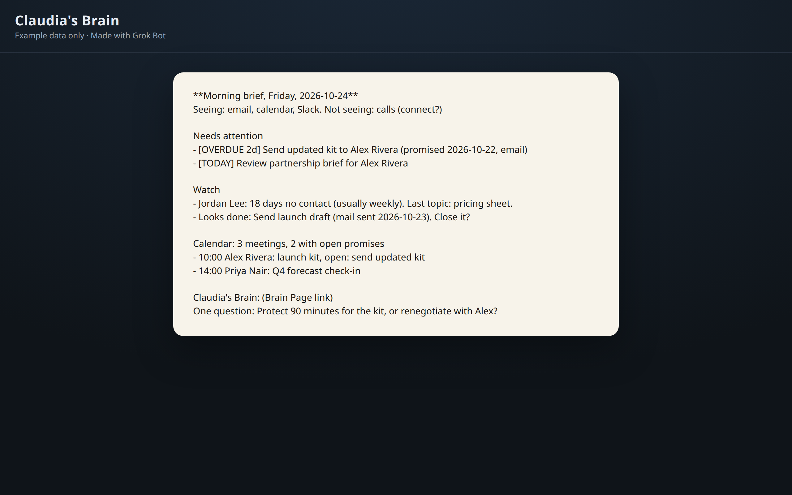
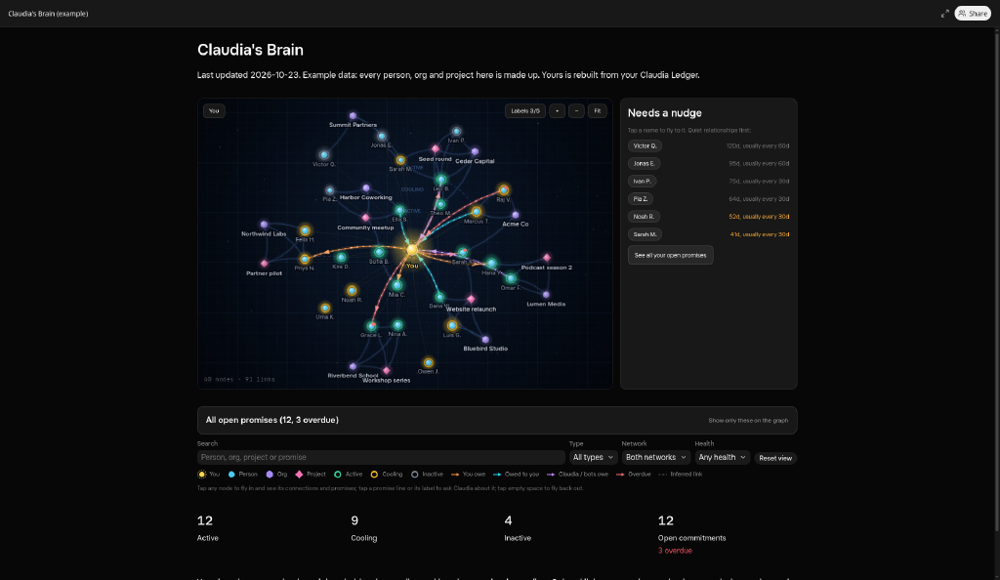
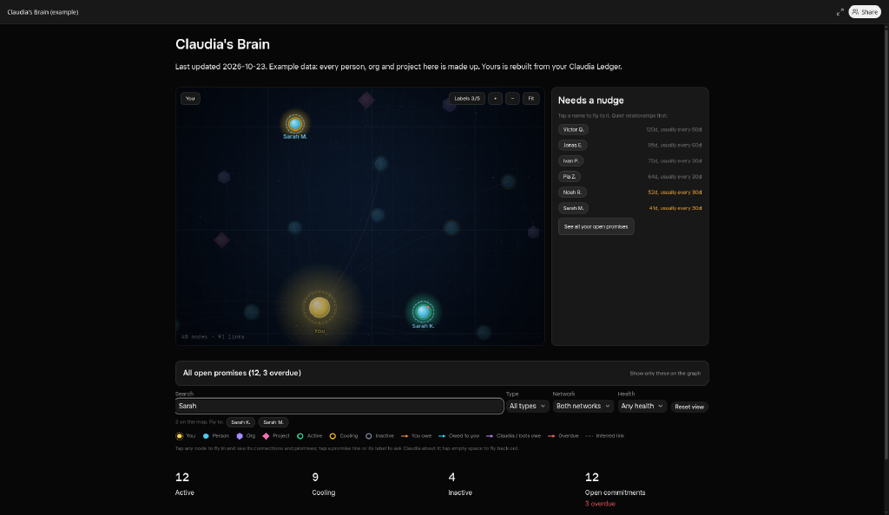
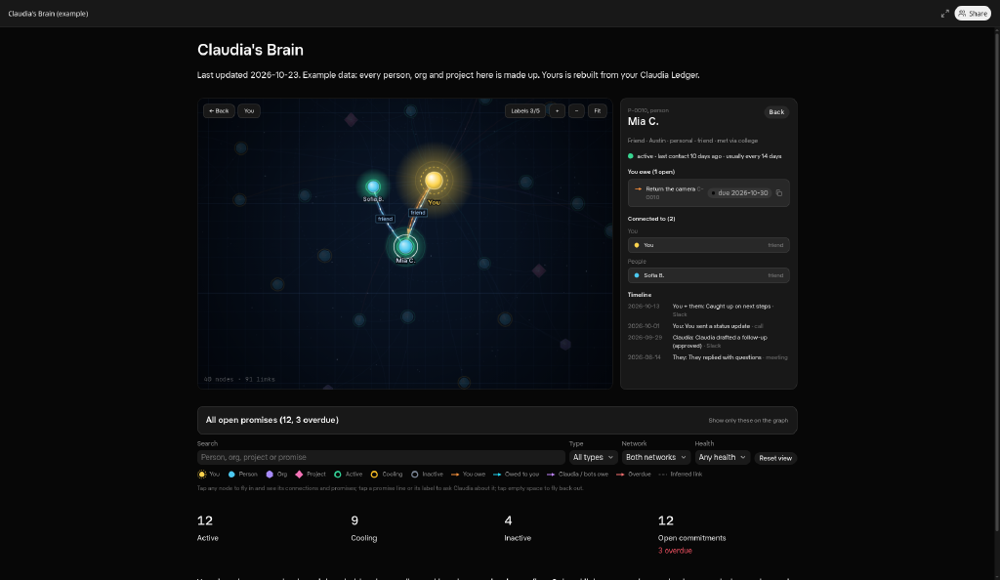
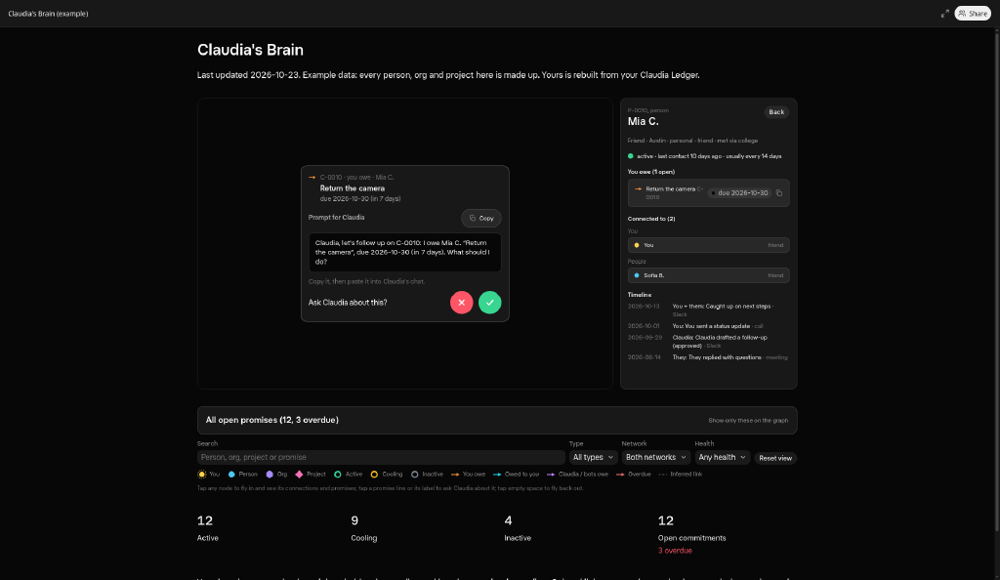

# Claudia, Chief of Staff

Never drop a promise again.

**Claudia** is a public [Grok Bot](https://x.ai/bot/AkJewmJ9D2DlMpBD5XaCG) that catches every "I'll send it Friday" across your email, Slack, and calls, warns you before something is late, and briefs you every morning on who needs you.

<p align="center">
  
</p>

Made with Grok Bot.

## What Claudia does

- **Catches promises** in email, Slack, calendar, and call notes, both ways (you owe / owed to you).
- **Warns before something is late** (48 hours out, due day, and overdue), with recovery options.
- **Morning brief:** urgency first (Needs attention, Watch, Calendar), with a coverage line for what she can and cannot see.
- **End-of-day meditate:** compares what she was instructed to do with what you adjusted, and proposes judgment rules. Nothing changes without your yes.
- **Weekly review:** wins, promise audit, relationship health, who to reconnect with, next week.
- **Routes substantial work** to specialist bots when you have a team, and keeps approvals with you.
- **Approval rule:** she never sends email, messages, posts, invites, purchases, or shares without your explicit yes in chat.

<p align="center">
  
</p>

## Claudia's Brain

A live people-and-promises Page with you at the center. Every person and promise she catches becomes a node. Day one it is a sketch; after a week it shows who is active or cooling.

<p align="center">
  
</p>

Search highlights matches. Open a person card for health, cadence, and open promises. Paste "Follow up on C-xxxx" back into chat when you want her next move.

| Full graph | Search for Sarah | Person card (Mia C.) | Ask Claudia about this? |
|------------|------------------|----------------------|-------------------------|
|  |  |  |  |

Real captures of the hosted Page with example data only. No private names.

## 3-minute welcome tour

On first chat she turns routines on quietly, then greets you, confirms name and timezone, connects the apps she can see through, runs a first catch over the last 7 days, builds Claudia's Brain, and asks a few quick questions (who matters, priorities, when to meditate). Setup is the go-ahead; she confirms the schedule in one line.

<p align="center">
  
</p>

## Install

Install the public template:

**[Claudia, Chief of Staff on x.ai](https://x.ai/bot/AkJewmJ9D2DlMpBD5XaCG)**

Each installed copy runs on its own Linux box with Python 3 and curl, reads your sources through the packed plugins (Gmail, Google Calendar, Slack, Otter, Google Drive, Google Sheets), and downloads the shared tools from this repo so every copy behaves the same. Each copy uses its own `$CLAUDIA_HOME` (and `$CLAUDIA_BOT_ID`) so two Claudias on one machine never share a ledger.

## What this repo is for

This repository is the **hosted backend** every installed Claudia downloads and runs:

| Path | Purpose |
|------|---------|
| `ledger/claudia_ledger.py` | Stdlib CLI: init, add/update (incl. commitment), close, merge, forget, health snapshot, backups/restore, check, export-brain, build-brain |
| `scan/claudia_scan.py` | Propose commitment candidates from normalized JSONL (bot judges and records) |
| `templates/` | Message shells + renderer for morning brief, catch, meditate, weekly review, welcome |
| `update/claudia_update.py` | Version check, MANIFEST.sha256 verify, atomic self-update |
| `setup/first_run.sh` | Idempotent first-run (never wipes existing ledger data) |
| `brain/claudia-brain.canvas.tsx` | Claudia's Brain Page (design fixed; data in the LEDGER-DATA block) |
| `docs/FOR-BOTS.md` | Exact operating manual the bot follows for every moment |
| `evals/` | Fictional promise-detection fixtures and precision/recall runner |
| `VERSION` / `MANIFEST.sha256` | Upgrade checks |

Bots must not hand-edit CSVs or redesign the Brain. Full command sequences: [`docs/FOR-BOTS.md`](docs/FOR-BOTS.md).

## Based on

Claudia is based on [claudia.aiadopters.club](https://claudia.aiadopters.club) and the original open-source Claudia at [github.com/kbanc85/claudia](https://github.com/kbanc85/claudia). This repo adapts that work for Grok Bot: deterministic CSV ledger on the bot's computer, hosted Brain Page, routines, and strict approval rules.

## Tests

```bash
python3 -m unittest discover -s ledger/example -p 'test_*.py' -v
python3 -m unittest discover -s templates -p 'test_*.py' -v
python3 -m unittest discover -s scan -p 'test_*.py' -v
python3 -m unittest discover -s update -p 'test_*.py' -v
python3 -m unittest discover -s tests -p 'test_*.py' -v
python3 evals/run_eval.py
export CLAUDIA_HOME="${TMPDIR:-/tmp}/claudia-demo" CLAUDIA_BOT_ID=demo
bash setup/first_run.sh --home "$CLAUDIA_HOME" --bot-id "$CLAUDIA_BOT_ID"
```

Installed bots keep scratch files under `$CLAUDIA_HOME/work/` (not a shared hard-coded temp path).

## Maintainers

```bash
python3 update/claudia_update.py manifest --root .
```

Regenerate `MANIFEST.sha256` last whenever shipped files change. `VERSION` is a single line; notes go in `CHANGELOG.md`.

Made with Grok Bot.
